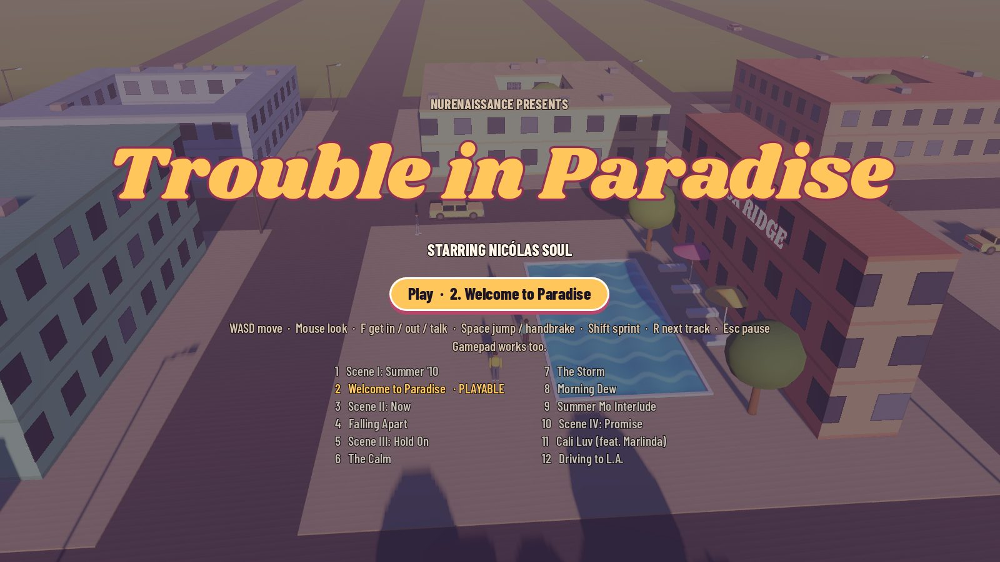
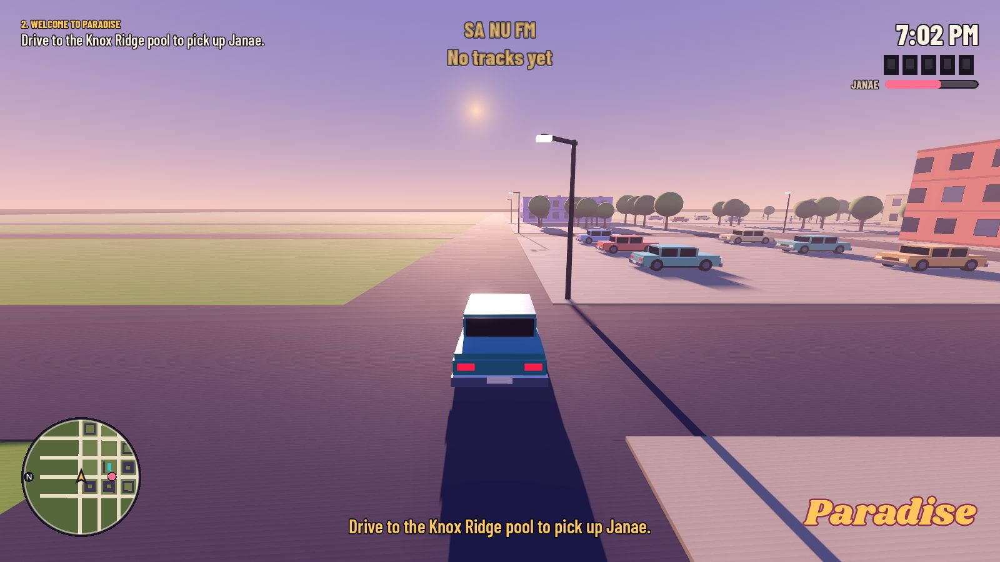
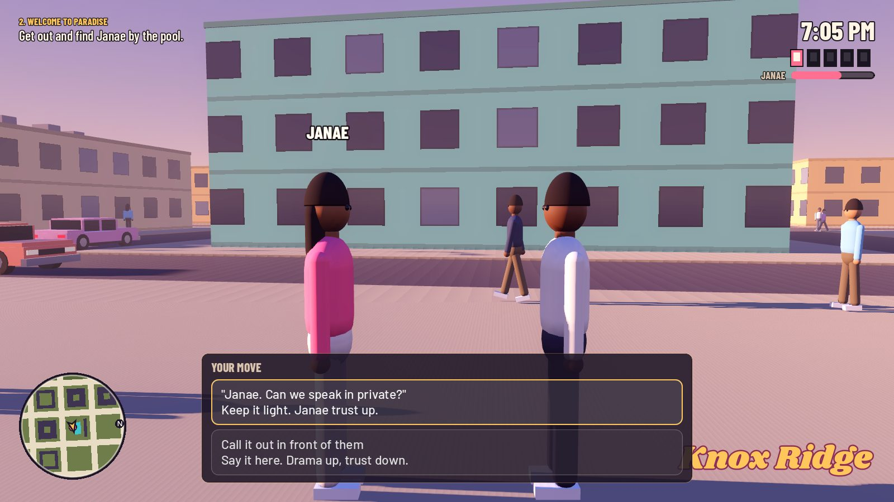
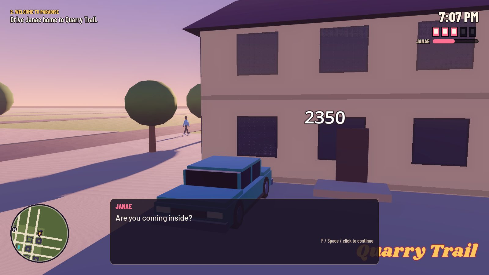
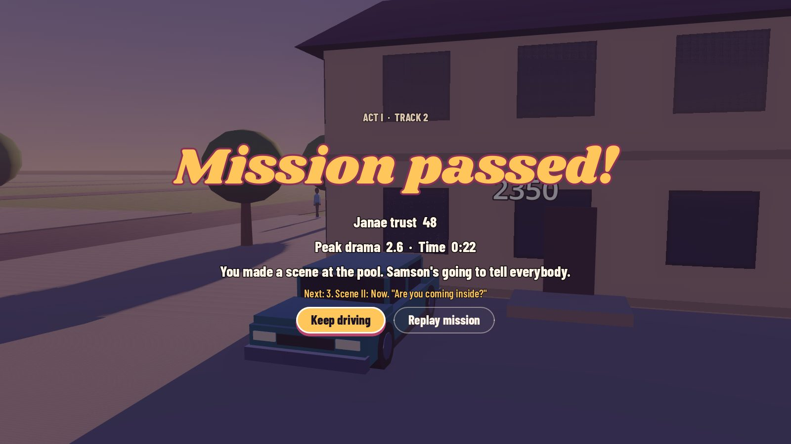

# Trouble in Paradise

A GTA-inspired, open-world story game based on Nicólas Soul's 2018 album *Trouble in Paradise*. Every mission is a track. You play Nick over one summer in Paradise, caught between Janae and Jessica, until the summer ends on the road to L.A.

Built in **Godot 4** (free). Third-person, San Andreas-style: walk, drive, a radio, a radar, a Drama meter instead of wanted stars, and dialogue choices that cost trust.



| | |
| --- | --- |
|  |  |
|  |  |

## Play it

1. Install **Godot 4.4** or newer, the standard version (not .NET): <https://godotengine.org/download>
2. Clone this repo (or download the ZIP from the green **Code** button).
3. Open Godot, click **Import**, pick `game/project.godot`.
4. Press **F5** (or the ▶ button in the top-right) to play.

### Controls

| Action | Keyboard + mouse | Controller |
| --- | --- | --- |
| Move / drive | WASD or arrow keys | Left stick, RT gas, LT brake |
| Look around | Mouse | Right stick |
| Get in / out of a car, talk | F (or E) | Y |
| Jump / handbrake | Space | X / RB |
| Sprint | Shift | A |
| Next radio track | R | D-pad right |
| Pause | Esc | Start |

## What's playable

**Mission 2, *Welcome to Paradise*** (Act I, track 2), straight from the 2018 script: drive from Quarry Trail to the Knox Ridge pool, find Janae with Samson and Justin, choose whether to pull her aside or make a scene, then drive her home while you argue. Free roam afterwards.

Also in: a 4 × 4-block town with traffic and people on the sidewalks, the sun setting into night (windows, street lights and headlights come on), a rotating radar, a Drama meter, a Janae trust bar, cutscene camera angles, and the SA NU FM car radio.

The rest of the album is mapped out in the [design doc](docs/design-doc.md).

## Where things are

| Folder | What's in it | Who usually works here |
| --- | --- | --- |
| `docs/design-doc.md` | Story, characters, all 12 missions, systems, roadmap | Everyone; writers own it |
| `game/data/dialogue/` | Every line of dialogue, as JSON. Edit text and choices without touching code. | Writers |
| `game/audio/radio/` | Songs for the SA NU FM radio. Drop `.ogg` or `.mp3` files in here. | Music |
| `game/scenes/world/town.tscn` | The town: buildings, roads, trees, the pool, Nick's house, mission markers | Level designers |
| `game/scenes/` (others) | Nick, the car, the NPC template, the main scene | Level designers, coders |
| `game/scripts/` | All game code (GDScript), one folder per area | Coders |
| `game/assets/` | Fonts now; 3D models, textures and sounds go here | Artists |
| `game/tests/` | Automated playthrough of the mission | Coders |
| `prototype/web-isometric/` | The first browser demo. Open `index.html` in any browser. | Reference only |

New to the project? Read [CONTRIBUTING.md](CONTRIBUTING.md) for how the team works together without overwriting each other.

## Placeholder art

Characters and cars are built from simple shapes in code (`humanoid_model.gd`, `car_model.gd`) so the game runs before real models exist. Each of those files says how to swap in a real `.glb` model when someone makes one.

## Running the automated test

```
godot --headless --path game res://tests/playthrough.tscn
```

It plays mission 2 start to finish (walks, drives, checks top speed and brakes, makes a choice, drives home) and prints `PLAYTHROUGH PASSED`. GitHub runs it on every pull request.

---

Story, music and characters © 2018 NuRenaissance. Fonts: Shrikhand and Barlow, SIL Open Font License (see `game/assets/fonts`).
