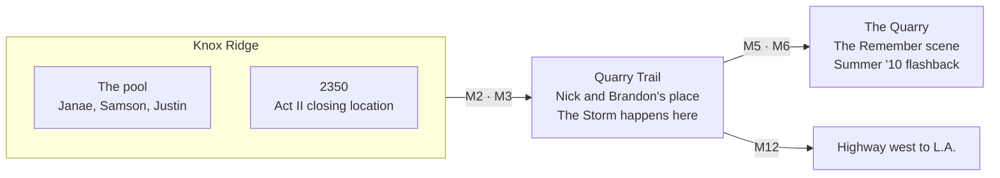

# Trouble in Paradise — Game Design Doc

Living version: the Claude Doc this was exported from (Oct 13, 2026). Edit this file in a PR, or edit the doc and re-export.

## Pitch

Trouble in Paradise is a third-person, open-world story game where every mission is a track from the 2018 album. You play Nick over one summer in Paradise, a college town built on Knox Ridge and the Quarry, caught between Janae and Jessica, until the summer ends on the road to L.A.

It borrows GTA's bones (a city to drive, a phone that hands out missions, a radio, a heat meter) but the danger is drama, not police. The script's own cut points become level boundaries: The Storm plays over the climax, Morning Dew over the credits.

Pillars:

- **Every mission is a song.** 12 tracks, 12 missions, scored by that track.
- **Drive the summer.** Free roam between scenes; the radio plays the Nicólas Soul catalog.
- **Choices cost trust.** What you say moves Janae, Jessica and Brandon, and the town talks.
- **The ending is a choice.** The script cuts on Nick's face; the player decides what he says.

## Story

Nick is dating Janae, who is deeply invested in him, but he is still in love with Jessica, his first love. Janae believes Jessica is only a childhood friend. The game follows the script's two sequences, then carries past its cliffhanger into the album's second half.

**Act I — the relationship (script Sequence One).** A 2010 flashback shows Nick and Jessica's summer. In the present, Nick picks Janae up from the Knox Ridge pool and finds her flirting with Samson, whom he can't stand. They argue, drive to his place on Quarry Trail and make up: he admits he's lost a lot of people and doesn't want to lose her.

**Act II — the storm (script Sequence Two).** Jessica comes back around. Nick and Jessica go to the Quarry for the "Remember" scene; Janae, arriving unannounced, follows them there. She goes back to Nick's place and gets even with his roommate Brandon. Nick and Jessica walk in on it, everyone turns on everyone, and the fight spills outside. One of the women forces Nick to choose. Camera on his face.

**Epilogue — the road (tracks 9–12, new).** The script stops at the choice. The game plays it out: an interlude summer, a promise, and the drive west to L.A., with a different passenger, or none, depending on the choice.

## Characters

Nick is the main playable character; Janae becomes playable for one tail mission, GTA V-style.

| Character | Who they are | In play |
| --- | --- | --- |
| Nick | The protagonist, played by Nicólas Soul. Overthinks; has lost people before. | Playable throughout. Drives, talks, chooses. |
| Janae | Nick's girlfriend. Confident, invested in him, quick to flip it back on him. | Trust meter. Playable in Scene III: Hold On (tailing Jessica's car). |
| Jessica | Nick's first love; Janae thinks she's just a childhood friend. | Trust meter. Drives her own car to the Quarry. |
| Brandon | Nick's roommate. Has feelings for Janae. | Trust meter. Video game minigame partner; betrays Nick in The Storm. |
| Samson | Psych major Nick doesn't get along with. | Rival. Hangs at the pool; a pressure point in Welcome to Paradise. |
| Justin | Samson's friend. | Background NPC at the pool. |

The album credits list Emily LaRoe as a co-star; her role in the game is an open question.

## World

Paradise is a small, drivable town built from the script's real locations, with the highway out of town as the final level.

The first Godot build has Knox Ridge and Quarry Trail inside a 4×4-block town; the Quarry and the highway come in later phases.

## Campaign

Twelve missions, one per track, in album order. Missions 2, 3 and 7 come straight from the 2018 script; the rest are new and open to rewrite.

| # | Track | Mission | Gameplay |
| --- | --- | --- | --- |
| 1 | Scene I: Summer '10 | Flashback: a summer day with Jessica, ending at the Quarry. | Tutorial. Walk, drive, talk. Sepia grade. |
| 2 | Welcome to Paradise | Pick Janae up from the Knox Ridge pool; she's with Samson and Justin. | Drive to marker; dialogue choice (pull her aside or go off in front of them). **Built.** |
| 3 | Scene II: Now | Drive Janae to Quarry Trail; "Are you coming inside?" Then games with Brandon. | Silent-drive dialogue; versus minigame with Brandon. |
| 4 | Falling Apart | Jessica texts. Janae texts. Both want the same afternoon. | Phone juggling; errands on a timer; Drama meter introduced. |
| 5 | Scene III: Hold On | Janae pulls up, sees Nick leave with Jessica, follows them. | Play as Janae: tail Jessica's car without being spotted. |
| 6 | The Calm | The "Remember" scene at the Quarry. | Walk-and-talk; memory pickups unlock 2010 flashes. |
| 7 | The Storm | Back at Nick's place, everyone turns on everyone. | Timed dialogue; keep the two apart; ends on the choice. |
| 8 | Morning Dew | The morning after. Credits roll in-game. | Slow drive home; consequences of the choice play out. |
| 9 | Summer Mo Interlude | What's left of the summer. | Free roam; side activities; radio. |
| 10 | Scene IV: Promise | A promise to whoever stayed, or to himself. | Branches three ways by the choice. |
| 11 | Cali Luv (feat. Marlinda) | The pull west. | Pack up; say goodbyes around town. |
| 12 | Driving to L.A. | The drive. | Highway sequence; passenger seat shows the ending. |

## Systems

The GTA loop stays (phone gives a mission, drive across town, play the scene, free roam), with drama standing in for crime.

| System | GTA source | How it works here |
| --- | --- | --- |
| Driving | Open-world driving | Physics car (Godot VehicleBody3D), chase camera, handbrake. Nick's sedan, Jessica's car, town traffic. |
| Drama meter | Wanted stars | Up to 5 phones instead of stars. Being seen with the wrong person, or a scene in public, raises it; rumors spread to Janae's or Jessica's friends. Lie low to clear it. |
| Trust | Relationship stats | One meter each for Janae, Jessica and Brandon. Dialogue choices and kept or missed plans move them. |
| Phone | GTA IV phone | Texts start missions and branch them; ignoring one has a cost. |
| Radio | In-car stations | SA NU FM plays the album in free roam; other stations play the rest of the catalog. Missions are scored by their own track. |
| Character switch | GTA V switching | Janae is playable in Scene III: Hold On. |
| Choice and endings | Story branches | The Storm ends on a choice: Janae, Jessica, or walk away. That decides missions 8–12 and who rides to L.A. |

## Art and audio direction

The game should look like the album cover moving: a film poster world, "Starring Nicólas Soul," act cards between chapters.

- **Camera:** third-person chase camera, San Andreas-style; low cinematic angles for cutscenes.
- **Palette by act:** sepia for Summer '10; warm gold summer for Act I; dusk purples for The Calm; deep blue night and rain for The Storm; pale morning for Morning Dew; desert sunset for Driving to L.A.
- **Title cards:** each mission opens on a card in the album's type, e.g. "Act I · 2. Welcome to Paradise."
- **Music:** each mission scored by its track. Stems where available, so The Calm can crossfade into The Storm as the scene turns.
- **Dialogue:** text boxes for now; voiced lines later, from the script's dialogue.
- **Rating:** the album carries a Parental Advisory, so the game sits around a Mature rating; the Storm scene implies rather than shows.

## Build roadmap

1. **Prototypes (done).** Browser isometric demo of mission 2 (`prototype/web-isometric`). First Godot 4 build: 3D town, walk and drive, mission 2.
2. **Vertical slice: Act I.** Missions 1–4. Real character models and car model, real tracks on the radio, Trust and Drama meters across missions, save game.
3. **Act II and endings.** Missions 5–8, character switch, the choice, three branches.
4. **Epilogue and polish.** Missions 9–12, the L.A. drive, voiced dialogue, release on itch.io and Steam.

Open questions:

- [ ] Is 2350 Jessica's place, or a unit at Knox Ridge?
- [ ] Do missions 9–12 follow the shape above, or is there a real story for that half?
- [ ] Does Marlinda (Cali Luv) appear as a character in L.A.?
